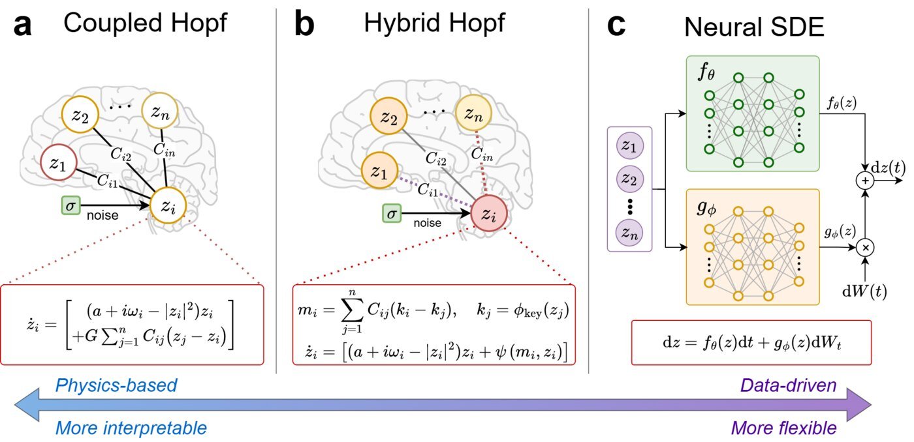

# Hybrid generative models of the brain

**An interactive, non-technical introduction to whole-brain modelling, from coupled oscillators to neural networks.**

  



Whole-brain models are systems of stochastic differential equations whose solutions look like recorded brain activity. Physics-based models (coupled oscillators) are interpretable but rigid; data-driven models (Neural SDEs) are flexible but data hungry and opaque. **Hybrid models** keep the oscillator in every brain region and learn only how regions interact.

The notebook [`hybrid_brain_models.ipynb`](hybrid_brain_models.ipynb) tells this story for a general audience, with the mathematics alongside for those who want it. It builds a small *virtual brain* with our package [`neuroscience-modeling`](https://github.com/DCN-FAU-AvH/neuroscience-modeling) and uses it to show, step by step:

1. how a single brain region is modelled by a Stuart–Landau (Hopf) oscillator, and what the bifurcation parameter does;
2. how many oscillators coupled through a connectome produce scanner-like signals;
3. how a real fMRI signal becomes a complex one (standardisation, band-pass filter, Hilbert transform), checked against the hidden ground truth;
4. what *functional connectivity* is and how it depends on the coupling strength;
5. why fitting a stochastic model by pointwise $L^2$ error fails (a silent model wins), while statistical descriptors work;
6. the three model families (Coupled Hopf, Hybrid Hopf, Neural SDE) and what they achieve on real data from the Human Connectome Project.

The notebook runs in about a minute on a laptop CPU. **It downloads no data and trains no model**; the results for real brains are quoted from the accompanying paper.

## Contents

| File | Description |
|---|---|
| [`hybrid_brain_models.ipynb`](hybrid_brain_models.ipynb) | The notebook, saved with all outputs |
| [`hybrid_brain_models.html`](hybrid_brain_models.html) | The same notebook as a stand-alone web page |
| [`plotting.py`](plotting.py) | Figure helpers used by the notebook (presentation only) |
| [`SUMMARY.md`](SUMMARY.md) / [`summary.html`](summary.html) | Short summary for the web |
| [`img/`](img) | Figures and animations shown in the notebook |

## Quick start

You need Python ≥ 3.13. In a terminal:

```bash
python3.13 -m venv .venv && source .venv/bin/activate                 # Windows: .venv\Scripts\activate
pip install torch --index-url https://download.pytorch.org/whl/cpu   # optional: CPU-only PyTorch is enough
pip install "torchsde @ git+https://github.com/dani2442/torchsde"    # torchsde fork with complex Brownian motion
pip install "neuroscience-control @ git+https://github.com/DCN-FAU-AvH/neuroscience-modeling"
pip install jupyterlab
jupyter lab hybrid_brain_models.ipynb
```

Install the `torchsde` fork **before** the package: the models evolve complex-valued states driven by complex Brownian motion, which the upstream `torchsde` release does not support.

With [`uv`](https://docs.astral.sh/uv/) you can instead clone the package and let it resolve everything:

```bash
git clone https://github.com/DCN-FAU-AvH/neuroscience-modeling
cd neuroscience-modeling && uv sync
uv run --with jupyterlab jupyter lab
```

Keep `plotting.py` and `img/` next to the notebook. To re-run it non-interactively:

```bash
jupyter nbconvert --to notebook --execute --inplace hybrid_brain_models.ipynb
jupyter nbconvert --to html --HTMLExporter.embed_images=True hybrid_brain_models.ipynb
```

Tested with Python 3.13 on Linux, with PyTorch 2.10 (CUDA build, run on CPU) and 2.14 (CPU build). All random seeds are fixed, so the figures are reproducible.

## The paper

> D. López-Montero, L. Liverani, E. Zuazua, X. Kobeleva. *Hybrid generative models of whole-brain dynamics balance data fidelity and interpretability.* Manuscript under review (2026).

```bibtex
@unpublished{lopezmontero2026hybrid,
  title  = {Hybrid generative models of whole-brain dynamics balance data fidelity and interpretability},
  author = {L{\'o}pez-Montero, Daniel and Liverani, Lorenzo and Zuazua, Enrique and Kobeleva, Xenia},
  note   = {Manuscript under review},
  year   = {2026}
}
```

The full training and evaluation pipeline, including the scripts to reproduce every figure of the paper, is in the [`neuroscience-modeling`](https://github.com/DCN-FAU-AvH/neuroscience-modeling) repository.

## Authors

Daniel López-Montero, Lorenzo Liverani and Enrique Zuazua ([Chair for Dynamics, Control, Machine Learning and Numerics](https://dcn.nat.fau.eu/), Alexander von Humboldt Professorship, FAU Erlangen-Nürnberg), and Xenia Kobeleva (Ruhr University Bochum and DZNE Bonn).

## License

Code is released under the MIT licence. The figures `workflow.jpg`, `architectures.jpg` and `models.gif` are from the paper above. The animations `fmri.gif` and `models.gif` show resting-state data from the Human Connectome Project.
