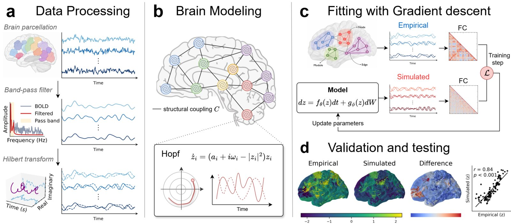
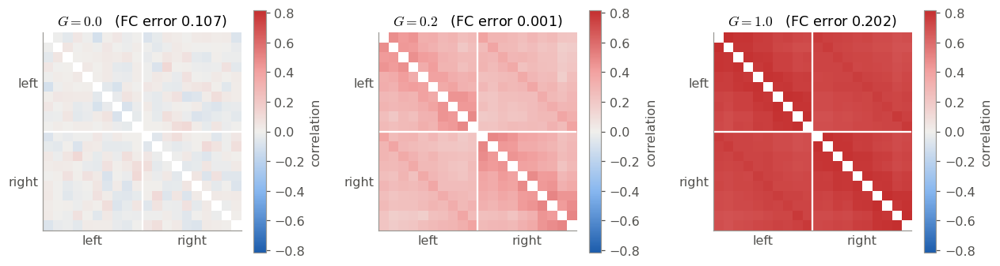
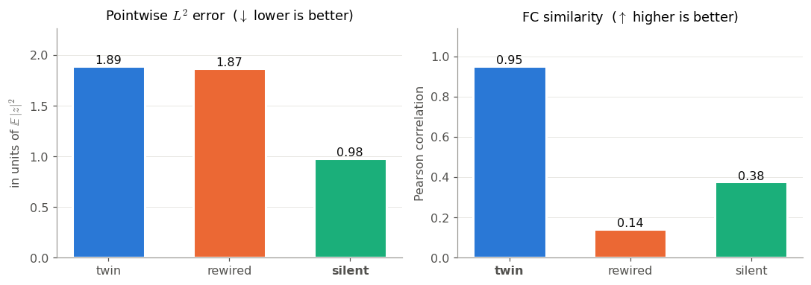
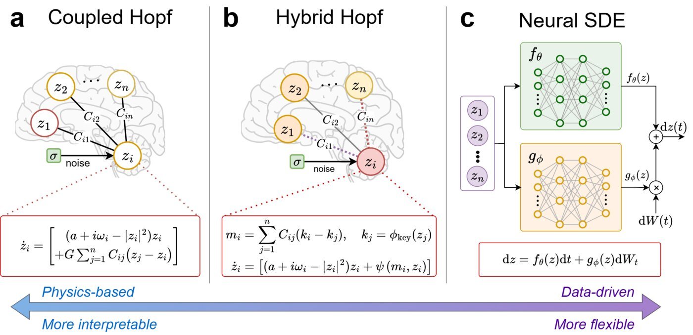

# Hybrid generative models of the brain: when physics meets machine learning

**Daniel López-Montero** — joint work with Lorenzo Liverani, Enrique Zuazua and Xenia Kobeleva 
Chair for Dynamics, Control, Machine Learning and Numerics (Alexander von Humboldt Professorship), FAU Erlangen-Nürnberg · October 2026

*From brain scans to a brain model: the scan is cut into regions, every region becomes an oscillator wired to the others, and the model is tuned until its activity looks like the measured one.*

Even at rest, the brain is never quiet. Slow, coordinated waves of activity travel between its regions, and functional MRI can record them. **Can we write equations that reproduce this activity**, and can we trust them enough to one day test a treatment on a virtual copy of a patient's brain before trying it on the patient?

This post accompanies a hands-on Jupyter notebook that explains, for a non-specialist audience, how *whole-brain models* work and why we propose **hybrid models**, which keep the physics we trust and let a neural network learn what we do not know. The notebook builds a small virtual brain with our open-source package and runs entirely on a laptop CPU in about a minute, with no data download and no model training.

## One region, one oscillator

Brain activity is rhythmic, so each brain region is described by the simplest equation that can start to oscillate, the Stuart–Landau oscillator. Regions are then coupled through a connectome, a matrix that says how strongly each pair of regions interacts. In our study this is the *functional connectome*, which describes how strongly the fMRI signals of each pair of regions rise and fall together in the training data. This gives the classical **Coupled Hopf model**:

$$
\mathrm{d}z_i=\Big[\big(a+i\omega_i-|z_i|^2\big)z_i+G\sum_{j} C_{ij}\big(z_j-z_i\big)\Big]\mathrm{d}t+\sigma\,\mathrm{d}W_i .
$$

Here $a$ says how close each region is to oscillating on its own, $\omega_i$ is its natural rhythm, $G$ is a single global coupling strength, and $\sigma\,\mathrm{d}W_i$ is random noise. Every parameter has a clear meaning, but the model is rigid. A single number $G$ and a fixed wiring cannot express everything a real brain does.

*Functional connectivity (who moves together with whom) of the notebook's virtual brain for three coupling strengths. Only the intermediate value reproduces the brain's pattern at the right level.*

## Compare statistics, not curves

The most obvious way to judge a model, measuring the distance between simulated and recorded curves (the $L^2$ error), fails for random systems. The model's noise is independent of the brain's noise, so the cross term of the expansion vanishes and only the model's own energy is left:

$$
\mathbb{E}\lVert\hat z-z\rVert^2\approx\mathbb{E}\lVert\hat z\rVert^2+\mathbb{E}\lVert z\rVert^2 .
$$

A model that does nothing therefore beats a perfect copy of the brain. The notebook demonstrates this in three lines of code:

*Three candidate models compared with the virtual brain. The pointwise $L^2$ error prefers a silent model and cannot tell the perfect "twin" from a wrongly wired brain; functional-connectivity similarity ranks them correctly.*

As in weather forecasting, we must compare the *climate* and not individual days. We therefore fit models to a combination of statistical descriptors that neuroscientists already use (functional connectivity, its phase-based version, how these patterns change over time, and metastability). Because all of them are differentiable, the model parameters can be optimised by gradient descent through the equation solver.

## The hybrid model

*From interpretable to flexible: the physics-based Coupled Hopf model, our Hybrid Hopf model, and a fully data-driven Neural stochastic differential equation (Neural SDE).*

Neural SDEs learn the whole dynamics with neural networks. They are flexible, but they are data hungry and their parameters mean nothing. Our **Hybrid Hopf model** keeps the oscillator in every region and replaces only the coupling, the least certain ingredient, with a small learned network that operates on a learnable wiring initialised from the functional connectome. Trained on resting-state fMRI from 94 subjects of the Human Connectome Project, it reproduced both the static and the dynamic descriptors of brain activity better than the physics-based and the purely data-driven models, and it did so consistently across repeated trainings:

| Model | Learnable parameters | FC corr ↑ | phase FC corr ↑ | phase FCD KS ↓ |
|---|---|---|---|---|
| Coupled Hopf | 2 | 0.913 | 0.783 | 0.208 |
| Neural SDE | ≈ 220 000 | 0.787 | 0.729 | 0.217 |
| **Hybrid Hopf** | ≈ 2 200 | **0.926** | **0.923** | **0.101** |

*Means over 10 trainings, evaluated on held-out subjects; see the notebook for the full table.*

The open questions are where mathematics comes in: how to balance many objectives at once (a Pareto front), and how to *control* a learned brain model, which is the path towards personalised stimulation therapies.

## Reproducibility statement

The notebook `hybrid_brain_models.ipynb` is fully reproducible. It uses no external data (the virtual brain is generated inside the notebook) and trains no model. All random seeds are fixed, and it runs in about one minute on a CPU (tested with Python 3.13 and PyTorch 2.10). The simulations, preprocessing and descriptors all use our package [`neuroscience-modeling`](https://github.com/DCN-FAU-AvH/neuroscience-modeling); the results quoted for real brains are taken from the accompanying paper.

**Repository with the notebook and code available at FAU DCN-AvH GitHub:** <https://github.com/DCN-FAU-AvH/neuroscience-modeling>

## References

1. D. López-Montero, L. Liverani, E. Zuazua, X. Kobeleva. *Hybrid generative models of whole-brain dynamics balance data fidelity and interpretability.* Manuscript under review (2026).
2. G. Deco, M. L. Kringelbach, V. K. Jirsa, P. Ritter. The dynamics of resting fluctuations in the brain: metastability and its dynamical cortical core. *Sci. Rep.* 7, 3095 (2017).
3. M. Breakspear. Dynamic models of large-scale brain activity. *Nat. Neurosci.* 20, 340–352 (2017).
4. P. Kidger, J. Foster, X. Li, T. Lyons. Neural SDEs as infinite-dimensional GANs. *ICML* (2021).
5. G. E. Karniadakis et al. Physics-informed machine learning. *Nat. Rev. Phys.* 3, 422–440 (2021).
